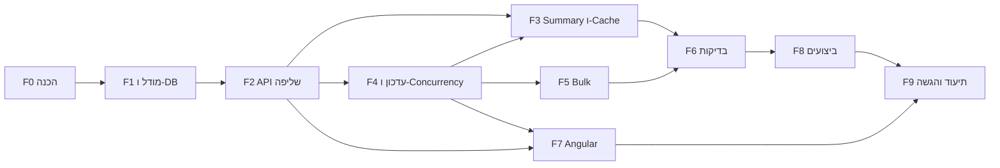

# תוכנית עבודה

פירוק דרישות המבדק ל-Features ול-Tasks: מה נדרש בכל משימה, התוצר, התלויות, הערכת מאמץ, והסעיף במבדק שהיא מממשת. התוכנית כוללת גם משימות שאינן כתיבת קוד: תכנון בסיס הנתונים, ביצועים, בדיקות, תיעוד והיערכות להרצה.

**הערכת המאמץ** היא בשעות עבודה לכל משימה. המסמך נכתב בסוף העבודה, ולכן ההערכות משקפות את היקף העבודה של כל משימה כפי שהוא נראה בדיעבד, ולא תכנון שנעשה מראש. בסוף המסמך יש טבלה של השינויים שנעשו במהלך העבודה לעומת הכיוון הראשוני.

## סיכום

| Feature | משימות | הערכה (שעות) |
|---|---|---|
| F0: הכנה ותכנון | 3 | 4 |
| F1: מודל נתונים ובסיס נתונים | 4 | 9 |
| F2: API שליפה | 3 | 8 |
| F3: Aggregations ו-Cache | 2 | 3 |
| F4: עדכון סטטוס, Concurrency ו-Audit | 3 | 7 |
| F5: Bulk Update | 2 | 4 |
| F6: בדיקות אוטומטיות | 4 | 8 |
| F7: Angular | 5 | 15 |
| F8: ביצועים | 3 | 6.5 |
| F9: תיעוד והיערכות להגשה | 4 | 7.5 |
| **סה"כ** | **33** | **72** |

## משימות

### F0: הכנה ותכנון

| מזהה | משימה | מה נדרש | תוצר | תלויות | שעות | סעיף במבדק |
|---|---|---|---|---|---|---|
| T0.1 | בדיקת סביבה ובחירת כלים | לבדוק אילו כלים מותקנים (.NET, Node, Angular CLI, SQL Server, Docker) ולבחור לפיהם | החלטה על SQL Server, Angular וגישת הבדיקות | | 1 | טכנולוגיות |
| T0.2 | מבנה הפתרון ו-Git | Solution עם 4 פרויקטים ו-2 פרויקטי בדיקות, הפניות בין השכבות, `.gitignore`, ריפו | Solution שמתקמפל, commit ראשון | T0.1 | 1 | §10 |
| T0.3 | תוכנית עבודה | פירוק האפיון למשימות, תלויות והערכות | המסמך הזה | | 2 | §9 |

### F1: מודל נתונים ובסיס נתונים

| מזהה | משימה | מה נדרש | תוצר | תלויות | שעות | סעיף במבדק |
|---|---|---|---|---|---|---|
| T1.1 | מודל Domain וכללי מעבר | ישות `ServiceRequest`, ישות Audit, enums, כללי מעבר במקום אחד | `Domain/` | T0.2 | 2 | המשימה, §2, §3 |
| T1.2 | תכנון בסיס הנתונים | טבלאות, `rowversion`, Foreign Key ל-Audit, תאריכים ב-UTC, ותכנון אינדקסים לפי תרחישי הסינון והמיון | רשימת אינדקסים ונימוק | T1.1 | 2 | §1, §6 |
| T1.3 | DbContext ו-Migration | Configurations, אינדקסים, Migration ראשון | `Infrastructure/Persistence/` | T1.2 | 2 | §6 |
| T1.4 | Seed של 100,000 רשומות | נתונים מגוונים, הכנסה מהירה (`SqlBulkCopy`), ניתן להרצה חוזרת | פקודת `seed` | T1.3 | 3 | המשימה (100K, יצירה חוזרת) |

### F2: API שליפה

| מזהה | משימה | מה נדרש | תוצר | תלויות | שעות | סעיף במבדק |
|---|---|---|---|---|---|---|
| T2.1 | חוזה ה-API ו-Validation | פרמטרי Pagination, סינון, חיפוש ומיון; whitelist למיון; הגבלת Page Size; שגיאות כ-`ProblemDetails` | `RequestQueryParameters`, Validator, Validation filter | T1.1 | 3 | §1, §10 |
| T2.2 | שאילתה בצד השרת | `IQueryable` עד הסוף, Projection ל-DTO, `CountAsync` + `Skip/Take`, `CancellationToken` | `GET /api/requests` | T1.3, T2.1 | 3 | §1 |
| T2.3 | טיפול בשגיאות ו-Logging | Global Exception Handler, Logging בנקודות משמעותיות | `GlobalExceptionHandler` | T0.2 | 2 | §10 |

### F3: Aggregations ו-Cache

| מזהה | משימה | מה נדרש | תוצר | תלויות | שעות | סעיף במבדק |
|---|---|---|---|---|---|---|
| T3.1 | Aggregations | כמויות לפי Status ולפי Priority, `GROUP BY` ב-DB | `GET /api/requests/summary` | T1.3 | 1.5 | §1 |
| T3.2 | Cache | בחירת הנתון, Expiration, Invalidation, תכנון לכמה מופעי שרת | `RequestSummaryService` | T3.1, T4.1 (Invalidation) | 1.5 | §7 |

### F4: עדכון סטטוס, Concurrency ו-Audit

| מזהה | משימה | מה נדרש | תוצר | תלויות | שעות | סעיף במבדק |
|---|---|---|---|---|---|---|
| T4.1 | עדכון סטטוס | 404, 400 לסטטוס או מעבר לא חוקי, 200 עם DTO | `PATCH /api/requests/{id}/status` | T1.1, T2.1 | 3 | §2 |
| T4.2 | Optimistic Concurrency | `rowVersion` מהלקוח, 409 ב-Conflict, הגנה מ-Lost Update ב-DB | בדיקה מוקדמת ו-`WHERE RowVersion` | T4.1 | 2 | §2 |
| T4.3 | Audit והיסטוריה | רשומת Audit באותה טרנזקציה; Endpoint להיסטוריה | `GET /api/requests/{id}/history` | T4.1 | 2 | §3 |

### F5: Bulk Update

| מזהה | משימה | מה נדרש | תוצר | תלויות | שעות | סעיף במבדק |
|---|---|---|---|---|---|---|
| T5.1 | הגדרת ההתנהגות | בחירה בין All-or-Nothing ל-Partial Success, חוזה התשובה, קוד HTTP, נימוק | החלטה מתועדת | T4.2 | 1 | §4 |
| T5.2 | מימוש | עד 100 פריטים, טעינה בשאילתה אחת, תוצאה לכל פריט, שימוש באותה לוגיקה כמו העדכון הבודד | `PATCH /api/requests/status/bulk` | T5.1, T4.3 | 3 | §4 |

### F6: בדיקות אוטומטיות

| מזהה | משימה | מה נדרש | תוצר | תלויות | שעות | סעיף במבדק |
|---|---|---|---|---|---|---|
| T6.1 | תשתית בדיקות | `WebApplicationFactory` מול SQL Server אמיתי, Database ייעודי, ניקוי בין בדיקות | `ApiFactory`, `IntegrationTestBase` | T2.2 | 2 | §8 |
| T6.2 | שליפה ו-Validation | סינון, מיון ודפדוף נכונים; 400 לפרמטרים לא תקינים | `GetRequestsTests` | T6.1 | 2 | §8 |
| T6.3 | Concurrency, Bulk ו-Cache | שני עדכונים בו-זמניים (200 ו-409, Audit אחד); מעבר אסור בלי Audit; Bulk מעורב; Invalidation | `UpdateStatusTests`, `BulkUpdateStatusTests`, `SummaryCacheTests` | T6.1, T5.2, T3.2 | 3 | §8 |
| T6.4 | Unit | כללי מעבר הסטטוס | `StatusTransitionValidatorTests` | T1.1 | 1 | §8 |

### F7: Angular

| מזהה | משימה | מה נדרש | תוצר | תלויות | שעות | סעיף במבדק |
|---|---|---|---|---|---|---|
| T7.1 | הקמה ושכבת API | פרויקט, Material, models, `RequestsApiService` יחיד, proxy ל-API | `core/` | T2.2 | 2 | §5 |
| T7.2 | רשימה | טבלה, מיון ודפדוף בצד השרת, מצבי Loading / Empty / Error | `RequestListComponent` | T7.1 | 4 | §5 |
| T7.3 | סינון וחיפוש | Debounce, ביטול בקשות קודמות (`switchMap`) | `RequestFiltersComponent` | T7.2 | 3 | §5 |
| T7.4 | עדכון סטטוס | דיאלוג, טיפול ב-409 עם הודעה ורענון | `StatusUpdateComponent` | T7.2, T4.2 | 3 | §5 |
| T7.5 | Summary והיסטוריה | הצגת Aggregations ורענונם אחרי עדכון; דיאלוג היסטוריה | `RequestSummaryComponent`, `RequestHistoryDialogComponent` | T7.2, T3.1, T4.3 | 3 | §5 |

### F8: ביצועים

| מזהה | משימה | מה נדרש | תוצר | תלויות | שעות | סעיף במבדק |
|---|---|---|---|---|---|---|
| T8.1 | שיטת מדידה | ה-SQL המדויק של EF, השוואה עם ובלי אינדקסים, Logical reads, זמן ו-Execution Plan | סקריפט מדידה ניתן להרצה חוזרת | T1.4, T2.2, T3.1 | 2 | §6 |
| T8.2 | מדידה וניתוח | לפחות שתי פעולות על 100K רשומות; זיהוי Bottlenecks והצעות שיפור, עם מדידה | `PERFORMANCE.md` | T8.1 | 3 | §6 |
| T8.3 | תיקון מה שהמדידה מצאה | מימוש שיפור שמצדיק את עצמו, ומדידה חוזרת | תיקון ומספרים מעודכנים | T8.2 | 1.5 | §6 |

### F9: תיעוד והיערכות להגשה

| מזהה | משימה | מה נדרש | תוצר | תלויות | שעות | סעיף במבדק |
|---|---|---|---|---|---|---|
| T9.1 | README והוראות הרצה | גרסאות, הרצה צעד אחר צעד, מבנה, Endpoints עם דוגמאות, Concurrency, Bulk, Cache. **בדיקת ההוראות על clone נקי** | `README.md` | כל ה-Features | 3 | §11, אופן ההגשה |
| T9.2 | החלטות טכנולוגיות | החלטות, חלופות, מגבלה ושיפור | `DECISIONS.md` | כל ה-Features | 2 | §11 |
| T9.3 | פירוט שימוש ב-AI | סעיף ב-README | תבנית למילוי | T9.1 | 0.5 | §11, שימוש בכלי AI |
| T9.4 | מעבר סופי והגשה | מעבר על כל סעיף במבדק ועל טבלת הניקוד, ריפו ב-GitHub | רשימת בדיקה, קישור לריפו | הכול | 2 | אופן ההגשה |

## סדר ביצוע ותלויות

1. **F0 → F1:** הסביבה, המבנה ומודל הנתונים הם הבסיס לכל השאר.
2. **F2:** השליפה היא הדרישה המרכזית, והיא מגדירה את ה-DTO וה-Validation שכל השאר משתמש בהם.
3. **F3, F4 ו-F5:** F4 לפני F5, כי ה-Bulk משתמש באותה לוגיקת עדכון. ה-Invalidation של F3 תלוי בעדכון של F4.
4. **F6:** הבדיקות אחרי שה-API יציב. בדיקת Unit לכללי המעבר נכתבה כבר עם F1.
5. **F7:** ה-Angular יכול להתחיל אחרי F2, במקביל ל-F3 עד F6. עדכון הסטטוס וההיסטוריה ב-UI תלויים ב-F4.
6. **F8:** מדידות רק אחרי שה-Seed, השליפה וה-Summary סופיים, ועל נתונים נקיים.
7. **F9:** התיעוד בסוף, כשההחלטות והמספרים סופיים. ההוראות נבדקות על clone נקי.

## שינויים במהלך העבודה

| שינוי | סיבה |
|---|---|
| חיפוש prefix ולא Full-Text | Full-Text מתעדכן באופן אסינכרוני (בדיקות לא יציבות) ולא נתמך ב-Docker image הרשמי ([DECISIONS.md](DECISIONS.md)) |
| סינון ארגון ומטפל כ-prefix ולא כהתאמה מדויקת | התגלה בבניית ה-UI: משתמש לא מקליד שם ארגון מלא |
| נתוני ה-Seed בעברית | הממשק בעברית, והמסך עם נתונים באנגלית לא נראה אחיד. נוספה בדיקת חיפוש בעברית |
| `OPTION (RECOMPILE)` לחיפוש (T8.3) | המדידות חשפו תוכנית שמורה שסורקת את כל הטבלה בחיפוש נדיר |
| בלי docker-compose | אין Docker בסביבת הפיתוח, וקובץ שלא נבדק עלול לא לעבוד אצל הבודק. במקומו, הוראות הרצה שנבדקו על clone נקי |
| בדיקות מול Database ייעודי ולא Testcontainers | אין Docker בסביבת הפיתוח |
